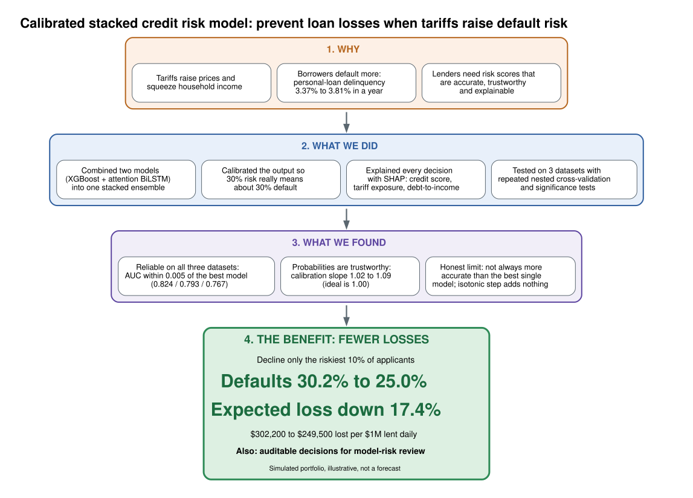

# Calibrated Stacked Ensembles for Explainable Credit Risk Scoring

Code and results for "Calibrated Stacked Ensembles for Explainable Credit Risk Scoring Under Tariff-Driven Volatility: An Attention-BiLSTM and XGBoost Framework" (R. Ghadiyaram and S. K. Kaata), 3ICT 2026.

The study compares logistic regression, XGBoost, LightGBM, CatBoost and an attention-BiLSTM with an out-of-fold stacked ensemble (logistic meta-learner, optional Platt or isotonic calibration). It uses repeated nested cross-validation, corrected paired tests, ECE, calibration slope and reliability diagrams, TreeSHAP and KernelSHAP explanations, and a portfolio-loss simulation.

## Framework


The diagram source is `docs/framework.dot`. Rebuild with `dot -Tsvg docs/framework.dot -o docs/framework.svg`.

## Repository layout
| Path | Contents |
|---|---|
| `pipeline_revision.py` | Synthetic generator, loaders, learners, nested CV with stacking and calibration |
| `analyze.py` | Tables, Nadeau-Bengio paired tests, reliability diagrams |
| `shap_figs.py` | TreeSHAP and KernelSHAP figures and rankings |
| `loss_sim.py` | Portfolio loss simulation on the simulated portfolio (Section VI-F) |
| `verify_paper.py` | Recomputes the paper's tables and key claims and compares them to the manuscript LaTeX |
| `notebooks/credit_risk_3ict_reproduce.ipynb` | One-shot Google Colab notebook, all files kept in a Google Drive folder |
| `data/` | South German Credit (`data/south_german_credit.asc`, `data/GermanCredit.csv`) and Taiwan credit-card default (`data/taiwan_credit.csv`) |
| `results/` | Per-fold metrics, meta-learner coefficients, SHAP rankings, loss simulation, `results/results.md`, package versions |
| `figures/` | Paper figures |
| `docs/` | Framework diagram (`framework.dot`, `framework.svg`, `framework.png`) |
| `logs/` | Logs of the reported run |

## Reproduce locally
```bash
pip install -r requirements.txt
python pipeline_revision.py --data synth --repeats 3 --out out
python pipeline_revision.py --data german --repeats 3 --out out
python pipeline_revision.py --data taiwan --repeats 2 --n_max 10000 --out out
python analyze.py
python shap_figs.py
python loss_sim.py
```
The Taiwan run uses 2 repeats (10 outer folds); the other two use 3 repeats (15 outer folds). Outputs go to `out/` and `out_shap/`. Set `CR_BASE` to use a different project root.

## Reproduce in Colab
Open the notebook, put the scripts and `data/south_german_credit.asc` in `MyDrive/credit_risk_3ict/code`, and run all cells. Finished datasets are skipped on re-run. On CPU the synthetic and Taiwan runs take about 20 minutes each and the German run about 11 minutes.

## Check the paper against the outputs
`verify_paper.py` takes the manuscript LaTeX and an output folder: `python verify_paper.py paper.tex results`. The manuscript is under review and is not distributed here. The result of the check on the reported run is in `logs/verify.log`.

## Data and attribution
- South German Credit (corrected): UCI Machine Learning Repository, doi 10.24432/C5QG88.
- Default of credit card clients (Taiwan): UCI Machine Learning Repository, id 350; Yeh and Lien, Expert Systems with Applications 36(2), 2009.
- The simulated tariff-stress portfolio is generated by `make_synth` in `pipeline_revision.py`. It and the loss figures are illustrative, not a forecast.

Seeds are fixed at 42. The neural learner can differ in the third decimal across hardware and package versions.

## License
MIT, see `LICENSE`.
